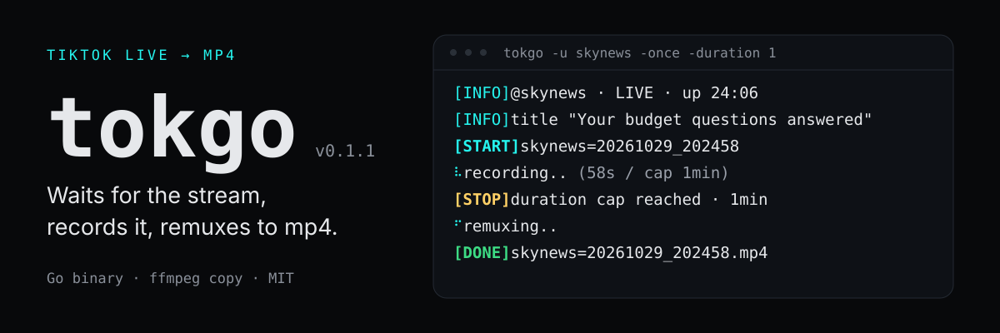

<p align="center">
  
</p>

**tokgo** records a TikTok live stream to a playable mp4. It waits for the
account to go live, records every reconnect, and remuxes the capture with ffmpeg
stream copy. One Go binary, no Python runtime, plus an interactive `tokgo tui`
monitor that records several accounts at once.

## Quick start

Needs Go 1.24+ and `ffmpeg` on `PATH`.

```bash
go build -o tokgo .
./tokgo -u somecreator -o ./captures
```

That waits for the next stream and records it. If the account is live right
now, add `-once` to record a single session and exit.

```bash
./tokgo -once -u somecreator -duration 30 -o ./captures
```

Press Ctrl-C once to stop cleanly: the capture is finalised and the mp4 is
written. Press it twice to abort immediately and keep the raw `.ts` segments.

## What a run looks like

```text
tokgo v0.2.0 — TikTok LIVE recorder
https://github.com/zfadhli/tokgo · MIT License

  target  @skynews · record once
  ffmpeg  9.0.2 · /usr/bin/ffmpeg
  output  /home/you/captures · 846.9 GB free
  cookies sessionid_ss ••••b9c2

[INFO]  @skynews · room 7702058376456391427 · LIVE · up 24:06
[INFO]  title "Your budget questions answered"
[START] skynews=20261029_202458
⠧ recording.. (58s / cap 1min)
[STOP]  duration cap reached · 1min
⠋ remuxing..
[DONE]  /home/you/captures/skynews=20261029_202458.mp4
```

The header names what will be recorded, which ffmpeg is used, where the file
goes with the space left there, and which login cookie was loaded (masked, or
`none · anonymous`).

Log lines carry a fixed-width tag: cyan `INFO` and `START`, yellow `STOP`, green
`DONE`, red `ERROR`. While it works, tokgo keeps one animated status line
instead of scrolling: elapsed time against the duration cap during capture, then
the remux, then a countdown while waiting for the next stream. A log line that
arrives mid-spinner clears the line, prints, and redraws it.

Piping the output, setting `NO_COLOR`, or running under `tokgo tui` drops colour
and motion: a spinner prints once as `o recording..` and the tags stay plain.

## Flags

| Flag | Description |
|------|-------------|
| `-url <URL>` | TikTok live URL (`https://www.tiktok.com/@name/live`, `https://vm.tiktok.com/...`) |
| `-user <NAMES>`, `-u` | Username(s), comma separated, `@` optional |
| `-room_id <ID>` | Numeric room id, bypasses username resolution |
| `-once` | Record a single attempt instead of waiting for the account to go live |
| `-automatic_interval <MIN>` | Minutes between liveness polls (default 3, minimum 1) |
| `-duration <MINUTES>` | Total capture budget per session, 0 for no cap |
| `-output <DIR>`, `-o` | Output directory (default: current directory) |
| `-proxy <URL>` | HTTP proxy for lookups; the video transfer always goes direct |
| `-telegram` | Upload the finished file to Telegram |
| `-ffmpeg-path <PATH>` | Custom ffmpeg binary |
| `-no-update-check` | Skip the release check |

The single-dash names match the reference CLI; the usual `--user` form works
too, and `tokgo help` (or `-h`) prints the same list.

Exactly one of `-user`, `-room_id`, `-url` is required. Several comma-separated
usernames record concurrently in whichever mode is selected.

## Modes

By default the run polls the user every `-automatic_interval` minutes and
records each session it catches, forever. A recording lasts until the stream
ends, the room goes offline, `-duration` is reached, or you press Ctrl-C.

`-once` resolves the room once, checks that it is live, records that one session
and exits. It is the mode to use when you already know the stream is up.

`-duration` is a total budget for one recording, not a per-connection timer, so
a flapping stream cannot over-record.

## TUI

```bash
tokgo tui
```

A Bubble Tea monitor for the same engine, built around recording several
accounts at once. Setup is one form: a wait/record-once chip, a targets field
that takes a comma or space separated list of usernames, live URLs or room ids,
then duration, poll interval, output directory, proxy and the Telegram toggle.
The form is turned into argv and validated by the same parser the flags use, so
it cannot accept a combination the CLI would reject or miss one it allows.

```text
tokgo v0.2.0 · monitor                          ● 1 recording · 3 targets · 00:15
────────────────────────────────────────────────────────────────────────────────
targets                                     activity
▸ @aljazeeraenglish REC      00:15     3 MB   • @natgeo: the user is not hostin…
  @natgeo           wait    -02:44            • @donut_ntp.42: the user is not …
  @donut_ntp.42     wait    -02:44            • @aljazeeraenglish · room 769963…
@aljazeeraenglish · room 76996314529211543…   • title "Al Jazeera English TikTo…
aljazeeraenglish=20261030_000319.000.ts       ▶ aljazeeraenglish=20261030_000319

  ↑↓ select · a add · x drop · ctrl+c stop · q quit
```

Every target gets a row with its phase, its timer and the bytes on disk, while
the activity pane keeps the runner's log. `↑`/`↓` moves the selection and the
block underneath shows the selected target's room, output file and latest detail
line. `a` adds a target to the running session without restarting the others, `x`
drops just the selected one.

Ctrl-C stops the run: the capture is finalised, the remux finishes, and every
row shows its final size and the total time it ran. Press it again to quit
without waiting for the remux. `r` goes back to the form with the fields still
filled in. Below 72 columns the activity pane is dropped rather than squeezed.

## How it works

Resolution and capture, against TikTok's own endpoints:

1. `www.tiktok.com/api-live/user/room` resolves the username to a room id. The
   endpoint answers a Chrome-shaped request without `X-Bogus`, a cookie or a
   signing service, so the lookup needs no third-party host.
2. `webcast.tiktok.com/webcast/room/check_alive` establishes liveness before any
   room data is trusted, so an ended room that still advertises stale stream
   URLs is not recorded.
3. `webcast.tiktok.com/webcast/room/info` yields the stream manifest. Each
   quality carries a numeric `level`; endpoints are tried best-first (origin,
   uhd, hd, sd, ld) for both FLV and HLS, then the legacy `flv_pull_url` tiers
   and finally RTMP.
4. The chosen endpoint is copied to disk through a 512 KiB buffer, re-checking
   liveness between reconnects. An endpoint that delivers nothing is abandoned
   in favour of the next candidate.

A `4003110` answer (login or region restriction) falls back to scraping the
public live page. That page is usually a WAF stub, so a login-gated room
normally needs cookies. See [Under the hood](#under-the-hood) for what is
actually reachable today.

## Output files

Capture writes one MPEG-TS segment per connection:
`skynews=20261029_202458.000.ts`, `.001.ts`, and so on. A new segment starts on
every reconnect, because a reconnected FLV restarts its timestamps and appending
it would make ffmpeg drop that connection's video. When ffmpeg cannot start at
all the capture goes straight to a raw `.flv` segment instead.

At the end, or on Ctrl-C, the segments are remuxed in order with
`ffmpeg -c copy` (stream copy, no quality loss) into
`skynews=20261029_202458.mp4`, and the segments are removed.

If the remux fails the segments are kept, so no captured byte is lost, and a
hard kill leaves the current `.ts` segment playable. If every advertised CDN
endpoint yields fewer than 4 KiB, no file is left behind and the run fails with
`unable to retrieve the live stream url`.

## Cookies and Telegram

`cookies.json` is a flat JSON object of cookie name to value, read from the
working directory. `sessionid_ss` is the one that carries a login:

```json
{ "sessionid_ss": "..." }
```

Cookies are sent to both `www.tiktok.com` and `webcast.tiktok.com`; the per-host
cookie jar would otherwise leave the webcast API unauthenticated, which is
exactly the endpoint a login-gated room needs. A missing file is fine.

`telegram.json` for `-telegram`:

```json
{ "bot_token": "...", "chat_id": "123456", "caption": "optional" }
```

## Limitations

- Login-gated rooms are fatal in every mode: the run stops with
  `live is private, login required` and exit status 1 instead of polling a room
  no retry can unlock.
- Username lookup is a single first-party endpoint. If TikTok answers it with a
  WAF block, pass `-room_id` or add `cookies.json`.
- The update check only reports the latest tag. It never replaces the binary.
- `-proxy` covers lookups, not the video download, which always goes direct so
  the transfer is not bottlenecked.

## Under the hood

<details>
<summary>TLS impersonation and proxies</summary>

TikTok's WAF fingerprints the TLS handshake, so every connection is made with a
Chrome ClientHello via [utls](https://github.com/refraction-networking/utls)
instead of Go's `crypto/tls`. Server-observed fingerprints:

| Client | JA4 |
| ------ | --- |
| Go `crypto/tls` | `t13d1311h2_f57a46bbacb6_e7c285222651` |
| this tool (utls, Chrome 120) | `t13d1516h1_8daaf6152771_02713d6af862` |

The profile is pinned to `HelloChrome_120` rather than `HelloChrome_Auto`: Auto
tracks the newest Chrome, sends post-quantum key shares that some middleboxes
drop, and drifts away from the `User-Agent` silently. ALPN is narrowed to
`http/1.1`, because utls presets ignore `Config.NextProtos` and a server would
otherwise agree on `h2` while Go's HTTP/1.1 transport talked past it.

The proxy is tunnelled inside the dialer with `Transport.Proxy` left nil:
`http.Transport` ignores `DialTLSContext` for proxied requests, so a proxied run
would silently fall back to Go's fingerprint. `-proxy` therefore gets
impersonation too, including `Basic` credentials in the `CONNECT`.

</details>

<details>
<summary>Stale <code>tt-target-idc</code> cookies</summary>

`tt-target-idc` and `tt-target-idc-sign` are ignored if present. They are routing
hints TikTok computes per session, so a value from a config file can only be
stale. Measured against a login-gated room with a valid `sessionid_ss`:

| `tt-target-idc` sent | `room/info` |
| -------------------- | ----------- |
| none | `0`, manifest present |
| `useast2a` | `4003110`, no manifest |
| `useast1a` | `0`, manifest present |
| `useast8` | `0`, manifest present |
| `my2` | `0`, manifest present |
| `sg2` | `0`, manifest present |
| `eu1` | `0`, manifest present |

Every value except `useast2a` behaves like sending nothing, and that one breaks
room lookups. The recorder strips both cookies from every request and warns once
when the config mentions one.

</details>

<details>
<summary>Restricted lives: what the fallbacks actually reach</summary>

A `4003110` answer means TikTok refuses the webcast room API for that room, and
cookies are the fix: with a valid `sessionid_ss` the same room records.

The only fallback without cookies is the public live page, scraping a
`.flv`/`.m3u8` url out of the HTML. It is unreliable: TikTok answers
`GET /@user/live` with a 1,485-byte SlardarWAF challenge stub that contains no
stream urls, with or without a warmed cookie jar. A real restricted live
(`@donut_ntp.42`, room `7701946275792554760`) showed the whole chain:
`check_alive` says `alive:true`, `room/info` answers `4003110`, the live page is
the WAF stub, and the Android webcast host answers `4003110` too.

`TestRestrictedLiveIsCapturable` walks that chain against a fake network.

</details>

<details>
<summary>Verified against the live service</summary>

Recorded on 2026-10-29 against `@aljazeeraenglish` and `@tiktok`:

- `-user` → room lookup → liveness → capture:
  `aljazeeraenglish=20261029_*.mp4`, ffprobe `h264 1280x720 25fps + aac`,
  2.0 MB for 8.18 s.
- 60 s cap with `-race`: exit 0, no data race, 62.19 s container, 1.93 Mbps,
  15 MB.
- `-url` and `-room_id` resolve to the same room and record.
- Ctrl-C once finalised and remuxed the capture; default mode recorded, then
  waited for the next poll.
- Multi-user: one live and one offline user ran concurrently; the live one
  landed, the dead one reported once with its `@name`, exit status 1.
- TLS impersonation reported JA4 `t13d1516h1_8daaf6152771_02713d6af862` by
  `tls.peet.ws`; `www.tiktok.com` negotiated `http/1.1` with that hello.
- Error paths: not-live, invalid URL, mutually exclusive flags, and TikTok's WAF
  answer (`403` with an empty body) each report one clear message.

</details>

## Design notes

- **`-duration` is a total budget** for one recording. A per-connection timer
  would reset on every reconnect, so a flapping stream would over-record.
- **The update check does not self-replace.** A compiled binary has nothing to
  overwrite, so the check only reports the latest tag, and only when
  `updateRepo` is set at build time.
- **Multi-user recordings are goroutines** sharing one process rather than
  forked processes, so one Ctrl-C reaches all of them.
- **The username lookup is unsigned.** `api-live/user/room` answers without
  `X-Bogus` as long as the request looks like a browser, so no sign service sits
  between the recorder and TikTok.
- **HTTP/1.1 only.** The Chrome hello advertises it deliberately; there is no
  HTTP/2 path.

## Tests

```bash
go test ./...              # offline: fake network, no ffmpeg, no TikTok
go test -race ./...
go test -tags live ./...   # real TikTok, real fingerprints, real proxy tunnel
```

Unit tests cover the quality ordering, the CLI validation matrix, the recorder
fallback and stop logic (with a fake network), ffmpeg argument construction, the
Telegram multipart request, the `CONNECT` tunnel framing (including bytes a proxy
sends in the same packet as its `200`), and a utls handshake against a Go TLS
server. Offline tests never touch the network.

The `live` tag adds checks that only make sense against the real service: the JA4
fingerprint is Chrome's and not `crypto/tls`'s, a Chrome hello completes against
`www.tiktok.com`, a request survives the hand-rolled `CONNECT` tunnel, and the
room lookup works through both TLS stacks.

## License

MIT. See [LICENSE](LICENSE).
